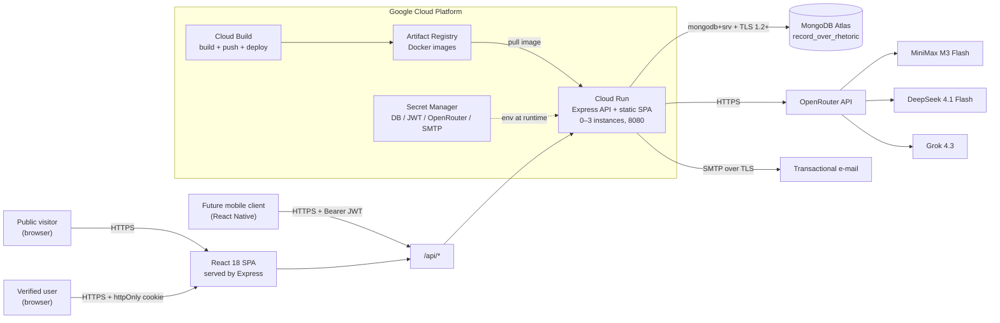
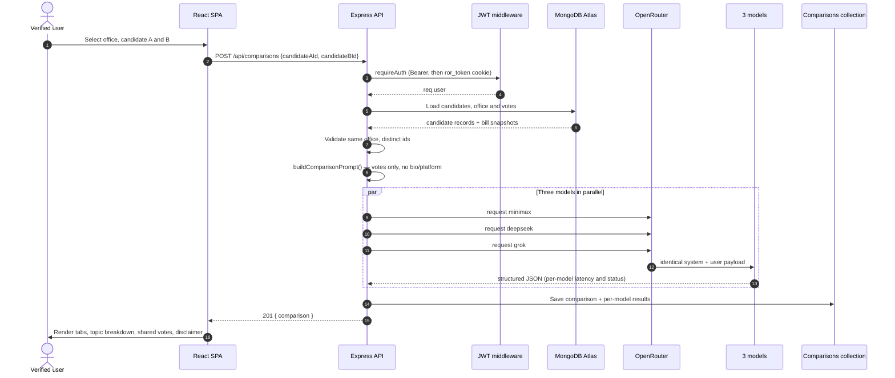

# Architecture — Record Over Rhetoric

Record Over Rhetoric is a MERN application that compares two candidates for the
same office using **only their recorded roll-call positions**. Three independent
OpenRouter models receive an identical, citation-constrained prompt and the UI
shows their analyses side by side.

## 1. System context

The React SPA is built at image-build time and served from the same Cloud Run
container as the API. One origin means no CORS in production, httpOnly cookies
work on the custom domain, and the SPA fallback is handled by Express.

## 2. Repository components

| Component | Responsibility |
| --- | --- |
| `client/` | Vite + React SPA: office/candidate pickers, three-tab model panel, history, auth screens. |
| `server/src/routes` | Express routers mounted under `/api`; JSON only. |
| `server/src/controllers` | Request validation, ownership checks, response shaping. |
| `server/src/services` | Auth tokens, e-mail, comparison data assembly, AI prompt + OpenRouter calls. |
| `server/src/models` | Mongoose schemas and indexes (see ER diagram). |
| `server/src/seed` | Idempotent fictional data + verified demo account. |
| `infra/terraform` | Artifact Registry, Secret Manager, Cloud Run v2, optional domain mapping. |
| `cloudbuild.yaml` | Build → push → deploy pipeline with SHA and `latest` tags. |
| `docker-compose.yml` | Local MongoDB 7 + API development container. |

## 3. Comparison request flow

Failure isolation: the three OpenRouter calls use `Promise.allSettled`. A model
that times out or returns invalid JSON is stored with `ok: false` and a safe
error string; the other two analyses still render. If the API key is missing,
`AI_ENABLED=false`, or `AI_FAKE=true`, deterministic canned analyses are used so
demos and tests never depend on the network.

## 4. Security and TLS story

**Browser → Cloud Run.** Cloud Run terminates TLS with a Google-managed
certificate on `*.run.app` and on a mapped custom domain / HTTPS load balancer.
HTTP is redirected to HTTPS. Helmet sets HSTS, `nosniff`, frame and referrer
policies. The SPA and API share an origin, so the JWT cookie is sent only to
that origin.

**Authentication.** Passwords are bcrypt-hashed (12 rounds). Login returns a
short-lived-to-7-day JWT both as an httpOnly, `SameSite=Lax`, `Secure` cookie
(named `ror_token`) for the web app and as a bearer token in the JSON body for
the future mobile client. Verification and reset tokens are stored as SHA-256
hashes with expiry (24 h / 1 h). Rate limits protect auth (20 / 15 min / IP) and
comparisons (10 / hour / user or IP).

**Cloud Run → MongoDB Atlas.** The `mongodb+srv://` connection uses TLS
automatically; Atlas requires TLS 1.2+ and presents a publicly trusted
certificate, so the Node driver verifies it by default. Atlas access is
restricted by IP access list; for Cloud Run, either allow the service's egress
range (or `0.0.0.0/0` with a strong DB user, documented as a trade-off) or use a
Serverless VPC connector with private endpoint / PrivateLink. Atlas credentials
live in Secret Manager, never in the image or repository.

**Cloud Run → OpenRouter and SMTP.** Both are outbound HTTPS/TLS. The OpenRouter
key and SMTP credentials are injected from Secret Manager at revision start.
The runtime service account holds only `roles/secretmanager.secretAccessor` on
the individual secrets; it has no broad project roles.

**Container.** Multi-stage build, production dependencies only, runs as the
unprivileged `node` user, no source maps, no `.env`, no test code in the final
image. Cloud Run enforces the container port and scales between 0 and 3
instances.

## 5. AI panel design

1. `getComparisonData` loads both candidates and their votes, rejecting
   different offices with HTTP 400 and missing candidates with HTTP 404.
2. `buildComparisonPrompt` sends bill number, title, neutral summary, topics,
   and each candidate's recorded position (`yes` / `no` / `abstain` / `absent`).
   It explicitly forbids using platforms, biographies, endorsements, ads, or
   rhetoric, and requires JSON with citations.
3. `compareVotingRecords` calls the same prompt against MiniMax, DeepSeek, and
   Grok concurrently with a per-model timeout (75 s default).
4. `callOpenRouter` tolerates fenced JSON, validates the structured shape
   (summary, dimensions, strengths/concerns, shared votes, confidence,
   disclaimer) and returns latency plus a non-leaking error on failure.
5. The comparison document snapshots the model id, status, latency and parsed
   analysis for each model, so history is reproducible.

The UI presents the panel as AI-assisted interpretation of the record, not an
endorsement, and displays a fictional-sample-data banner whenever seeded data
is shown.

## 6. Why GCP instead of DigitalOcean

The course template suggests DigitalOcean, but this project intentionally uses
Google Cloud Platform. Cloud Run provides managed HTTPS, scale-to-zero,
revision-based rollbacks, and a documented path to a custom domain with managed
certificates without operating a VM. Artifact Registry and Cloud Build integrate
directly with Cloud Run, and Secret Manager gives per-secret IAM. MongoDB Atlas
remains the remote database on either platform. No DigitalOcean resources are
used or documented.

## 7. Operational properties

| Property | Value |
| --- | --- |
| Runtime port | `8080` (Cloud Run injects `PORT`) |
| Instances | min 0, max 3 |
| CPU / memory | 1 vCPU / 512 MiB per instance |
| Request timeout | 300 s (AI panel allows up to 75 s per model) |
| Health check | `GET /api/health` returns `{ status, uptime, db }` |
| Image tags | `:<commit-sha>` and `:latest` |
| Secrets | 8 Secret Manager entries, referenced by `latest` |
| Observability | Cloud Logging from stdout; Cloud Run request metrics |
