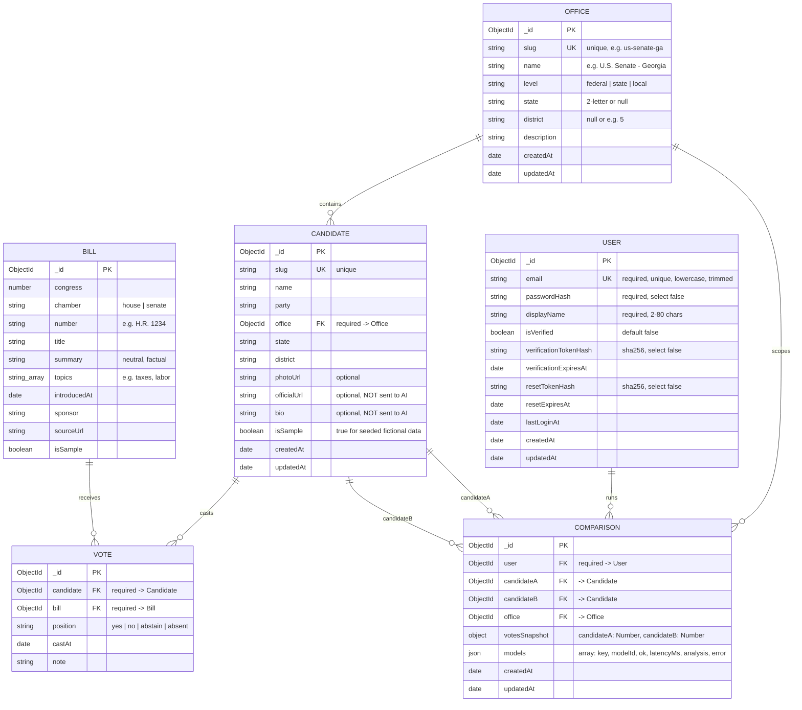

# ER Diagram — Record Over Rhetoric

Matches §6 of `docs/PROJECT_SPEC.md` (Mongoose models in `server/src/models`).

Unique / compound indexes: `User.email`; `Office.slug`; `Candidate.slug`;
`Candidate.office`; `Vote {candidate, bill}` unique; `Comparison {user, createdAt}`.
