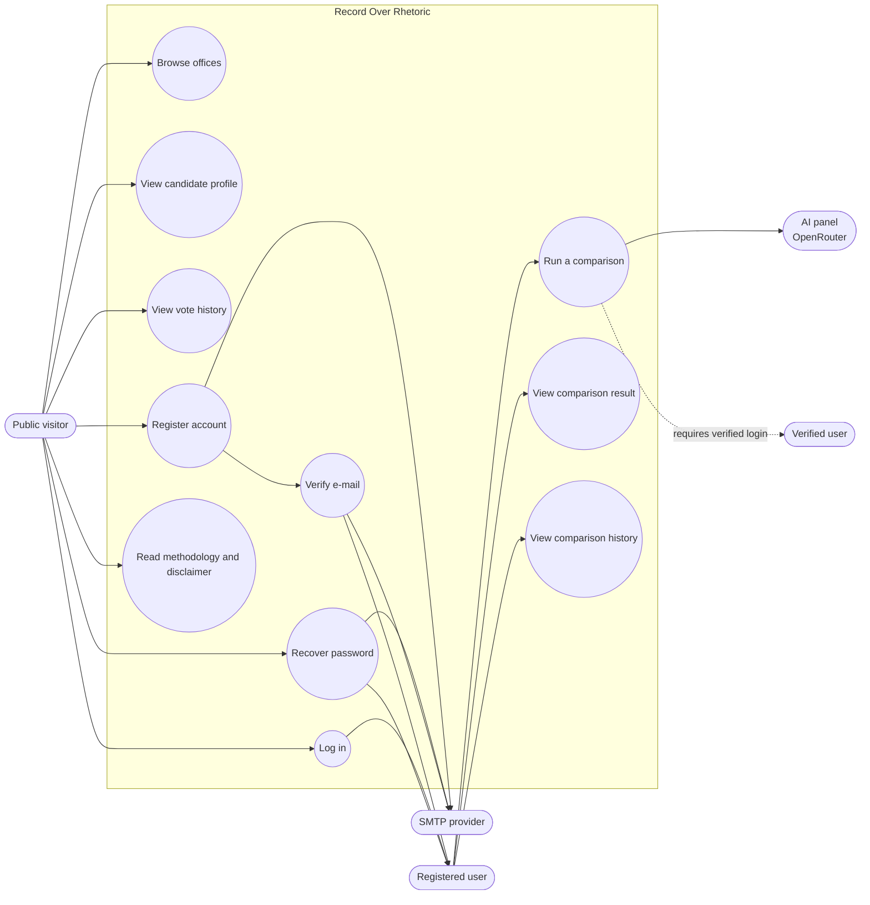

# Use Case Diagram — Record Over Rhetoric

Mermaid does not have a native UML use-case diagram type, so this uses a
flowchart with a system boundary. Ovals are use cases; stadium shapes are actors.

Notes:

- Comparisons require an authenticated, e-mail-verified account.
- The AI panel and SMTP provider are external systems, not actors who initiate
  use cases.
- All browsing and result viewing is public except a user's saved history.
